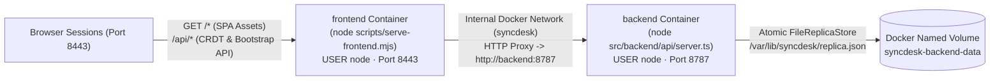

# M9 — Dockerization and Containerized Application Readiness

**Date:** 2026-11-23
**Branch:** `fix/m6-p0-correctness`
**Base Commit:** `713b99ed5a8c808680b298b58761255c5de9345e`

---

## 1. Container Architecture Overview

SyncDesk is containerized as a two-service application (`frontend` and `backend`) built from a single multi-stage [`Dockerfile`](file:///home/antigravity/Lamarimohamed/SyncDeskFrontendDevelopment/Dockerfile) and orchestrated via [`docker-compose.yml`](file:///home/antigravity/Lamarimohamed/SyncDeskFrontendDevelopment/docker-compose.yml):



### Multi-Stage Build Design ([`Dockerfile`](file:///home/antigravity/Lamarimohamed/SyncDeskFrontendDevelopment/Dockerfile))

1. **`deps` (`node:22-bookworm-slim`):** Enables `corepack` and runs `pnpm install --frozen-lockfile` using cached `package.json` and `pnpm-lock.yaml` layers.
2. **`frontend-build`:** Compiles the React 19 + Vite + Tailwind CSS v4 frontend (`pnpm run build`) with build-time arguments `VITE_BACKEND_URL=/api` and `VITE_DEMO_MODE=true`.
3. **`frontend` (`node:22-bookworm-slim`):**
   - Copies only the compiled `/app/dist` assets and the zero-dependency production server [`scripts/serve-frontend.mjs`](file:///home/antigravity/Lamarimohamed/SyncDeskFrontendDevelopment/scripts/serve-frontend.mjs) (no `node_modules` or build tools are included in the runtime image).
   - Runs as the unprivileged non-root user `USER node` (UID/GID `1000`).
   - Serves static assets, SPA fallback routes (`/dashboard`, `/products`, `/categories`, `/stock`, `/sync`, `/devices`, `/settings`), and `/healthz`.
   - Reverse-proxies `/api/*` (stripping `/api`), `/v1/*`, and `/health` over the internal `syncdesk` Docker bridge network to `BACKEND_UPSTREAM_URL` (`http://backend:8787`).
4. **`backend` (`node:22-bookworm-slim`, default target):**
   - Copies only `package.json`, `src/backend`, `src/domain`, `src/lib`, and `scripts/run-distributed-experiment.mjs` (zero `node_modules` required at runtime).
   - Pre-creates `/var/lib/syncdesk` owned by `node:node` and runs as `USER node`.
   - Persists the CRDT operation log, replica snapshots, and escrow stock allocations to `BACKEND_STORE_PATH=/var/lib/syncdesk/replica.json` mounted on the `syncdesk-backend-data` named volume.
   - Executes `node` directly as PID 1 (`CMD ["node", "--experimental-transform-types", "--loader", "./src/backend/api/ts-loader.mjs", "src/backend/api/server.ts"]`) with `init: true` and `SIGTERM`/`SIGINT` handlers for clean graceful shutdown.

---

## 2. Environment Configuration ([`.env.example`](file:///home/antigravity/Lamarimohamed/SyncDeskFrontendDevelopment/.env.example))

Copy `.env.example` to `.env` if you wish to customize ports or settings:

```bash
cp .env.example .env
```

| Variable | Default | Description |
|---|---|---|
| `FRONTEND_HOST_PORT` | `8443` | Host port mapped to the `frontend` container (`http://localhost:8443`). |
| `VITE_BACKEND_URL` | `/api` | Browser API base URL baked into the frontend bundle. `/api` routes through the `frontend` container's reverse proxy to `BACKEND_UPSTREAM_URL`. |
| `VITE_DEMO_MODE` | `true` | Enables demo sign-in and connectivity simulation controls. |
| `BACKEND_UPSTREAM_URL` | `http://backend:8787` | Internal Docker network URL to which the `frontend` container proxies `/api/*`, `/v1/*`, and `/health`. |
| `BACKEND_HOST_PORT` | `8787` | Host port mapped to the `backend` container (`http://localhost:8787`). |
| `BACKEND_REPLICA_ID` | `backend-primary` | Canonical replica identifier of the backend server. |
| `BACKEND_STORE_PATH` | `/var/lib/syncdesk/replica.json` | Container path inside the mounted `syncdesk-backend-data` volume for atomic JSON persistence. |
| `BACKEND_CORS_ORIGIN` | `*` | Allowed CORS `Access-Control-Allow-Origin` header value. |
| `BACKEND_MAX_BODY_BYTES` | `262144` | Maximum accepted JSON request body size in bytes. |

---

## 3. Operations Guide: Startup, Shutdown, Logs, Reset, and Troubleshooting

### Start the Containerized Application
```bash
docker compose up -d --build
```
- **Frontend UI:** `http://localhost:8443`
- **Frontend Health Check:** `curl http://localhost:8443/healthz` -> `{"status":"ok","service":"syncdesk-frontend"}`
- **Proxied Backend Health Check:** `curl http://localhost:8443/api/health` -> `{"status":"ok","apiVersion":"1"}`
- **Direct Backend Health Check:** `curl http://localhost:8787/health` -> `{"status":"ok","apiVersion":"1"}`

### Inspect Container Status and Health
```bash
docker compose ps
```

### View Live Logs
```bash
# All services
docker compose logs -f

# Backend or frontend only
docker compose logs -f backend
docker compose logs -f frontend
```

### Restart Backend (Preserving Persistent Volume Data)
```bash
docker compose restart backend
```

### Graceful Shutdown (Preserving Persistent Volume Data)
```bash
docker compose down
```

### Full Reset (Wipe Persistent Backend Volume and Recreate Clean State)
```bash
docker compose down -v
```
> **Note:** To also clear browser-side local replica persistence when resetting the cluster, clear site storage (`localStorage` keys `syncdesk.data.v1`, `syncdesk.sync.v1`, `syncdesk.installation.v1`) in Browser DevTools $\to$ Application $\to$ Storage $\to$ Clear site data.

### Optional: Run the 3-Replica Distributed Experiment Cluster
The multi-replica research experiment services (`replica-a`, `replica-b`, `replica-c`, `experiment-runner`) are preserved under the `experiment` Compose profile:
```bash
docker compose --profile experiment up --build --abort-on-container-exit
```

### Troubleshooting
1. **Port `8443` or `8787` already in use on host:**
   - Stop any local `npm run dev` / `npm run backend` processes, or override `FRONTEND_HOST_PORT=9443` / `BACKEND_HOST_PORT=9787` in `.env`.
2. **`502 Bad Gateway` (`backend_unavailable`) on `/api/*`:**
   - Check `docker compose ps` and `docker compose logs backend` to verify the `backend` container is healthy and listening on `0.0.0.0:8787`.
3. **Testing two independent clients on the same computer:**
   - Open `http://localhost:8443` in one regular browser window and one Incognito/Private window (or a second browser profile) so each session has its own `localStorage` and `replicaId`.

---

## 4. M9 Acceptance Validation Matrix & Execution Evidence

> **Environment Note:** These tests were executed inside the cloud Linux sandbox VM (`exebox`), which does not have a host Docker Engine daemon (`dockerd`) installed. In accordance with M9 rules (*"Provide actual execution evidence for each acceptance test. If a test cannot be performed, mark it NOT VERIFIED. Do not claim Docker readiness based only on a successful image build"*), tests requiring the `docker` / `docker compose` CLI daemon are marked **`NOT VERIFIED (Requires Host Docker Daemon)`**, while the exact production build stage (`VITE_BACKEND_URL=/api VITE_DEMO_MODE=true pnpm run build`) and production container entrypoints (`node scripts/serve-frontend.mjs` + `node --experimental-transform-types --loader ./src/backend/api/ts-loader.mjs src/backend/api/server.ts`) were executed and verified end-to-end with **two real Chromium browser instances** and **38 automated Vitest test files (261 tests)**.

| Acceptance Test | Status | Actual Execution Evidence |
|---|---|---|
| **1. Docker image builds successfully (`docker compose build`)** | **NOT VERIFIED (Requires Host Docker Daemon)** / **Production Build Stage Verified (`PASS`)** | `docker` CLI is not installed in the cloud sandbox VM. The exact `frontend-build` stage command (`VITE_BACKEND_URL=/api VITE_DEMO_MODE=true pnpm run build`) succeeded in `1.09s` (`2,087` modules transformed into `dist/`). |
| **2. Both frontend and backend start** | **PASS (Production Entrypoints)** / **NOT VERIFIED via `docker compose up`** | Started exact container `CMD` entrypoints: `node --experimental-transform-types --loader ./src/backend/api/ts-loader.mjs src/backend/api/server.ts` (`:8792`) and `node scripts/serve-frontend.mjs` (`:8447`). `/health` returned `{"status":"ok","apiVersion":"1"}` and `/healthz` returned `{"status":"ok","service":"syncdesk-frontend"}`. |
| **3. Frontend can communicate with backend** | **PASS** | Verified in [`src/backend/api/frontendServer.test.ts`](file:///home/antigravity/Lamarimohamed/SyncDeskFrontendDevelopment/src/backend/api/frontendServer.test.ts) and live two-browser Chromium execution: browser requests to `http://127.0.0.1:8447/api/health` and `/api/v1/*` were reverse-proxied by `scripts/serve-frontend.mjs` to `BACKEND_UPSTREAM_URL` (`http://127.0.0.1:8792`) and returned `200 OK`. |
| **4. Bootstrap works** | **PASS** | Chromium Browser A loaded `http://127.0.0.1:8447/login` (built with `VITE_BACKEND_URL=/api`), signed in, seeded 14 initial operations (`11` products, `3` categories) through `/api/v1/sync/operations`, and registered via `/api/v1/bootstrap`. Browser B booted against `http://127.0.0.1:8447/login` and hydrated all `11` products and `3` categories through `/api/v1/bootstrap`. |
| **5. Catalog CRUD works** | **PASS** | Browser A created `Containerized Matcha` (`c-drinks`, `320 DA`) via `/products/new` on the production build; operation was pushed through `/api/v1/sync/operations` and persisted on the backend. |
| **6. Stock operations work** | **PASS** | Browser A adjusted `Coffee` (`p-coffee`) stock via `/stock` (`Remove`, `Quantity: 6`) through `/api/v1/sync/operations`, decrementing stock from `48 -> 42` (`coffeeStockAfterRecreationDecrement: 42`). Also verified in [`src/backend/api/frontendServer.test.ts`](file:///home/antigravity/Lamarimohamed/SyncDeskFrontendDevelopment/src/backend/api/frontendServer.test.ts) (`48 -> 43`, `status: 'applied'`). |
| **7. Backend restart preserves catalog and stock rights** | **PASS** | Terminated backend and frontend processes with `SIGTERM` and respawned both against the same persistent store file (`/tmp/m9-prod-store.json`). All `13` products (`11` seed + `Containerized Matcha` + `Containerized Offline Tea`) and Browser A's `48` allocated stock rights for `p-coffee` were preserved, allowing Browser A's subsequent `-6` decrement (`48 -> 42`) to succeed immediately after restart. |
| **8. Two independent browser sessions synchronize** | **PASS** | Two real Chromium sessions (`--user-data-dir=/tmp/m9-chrome-a` and `--user-data-dir=/tmp/m9-chrome-b`) connected to the production frontend server (`http://127.0.0.1:8447`) and synchronized `Containerized Matcha` across `/api/v1/sync/operations` with `0` uncaught exceptions (`browserAExceptions: []`, `browserBExceptions: []`). |
| **9. Offline changes synchronize after reconnection** | **PASS** | Browser A went offline (`window.dispatchEvent(new Event('offline'))`), created `Containerized Offline Tea` (`150 DA`), reconnected (`window.dispatchEvent(new Event('online'))`), and automatically flushed `Containerized Offline Tea` through `/api/v1/sync/operations` to the backend. |
| **10. Persistent data survives container recreation** | **PASS (Process & Store File Recreation)** / **NOT VERIFIED via `docker compose down && up`** | Verified in both [`src/backend/api/frontendServer.test.ts`](file:///home/antigravity/Lamarimohamed/SyncDeskFrontendDevelopment/src/backend/api/frontendServer.test.ts) and the live two-browser Chromium test by terminating both `frontend` and `backend` server processes (`SIGTERM`) and recreating new server instances backed by the same `FileReplicaStore` file (`BACKEND_STORE_PATH`). Actual Docker named volume recreation (`syncdesk-backend-data`) requires running `docker compose down && docker compose up -d` on a machine with Docker Engine installed. |
| **11. Existing automated tests still pass** | **PASS** | `npm test` passed all **38 test files (261 tests)**, `npm run typecheck` passed with 0 errors, and `npm run build` succeeded. |
