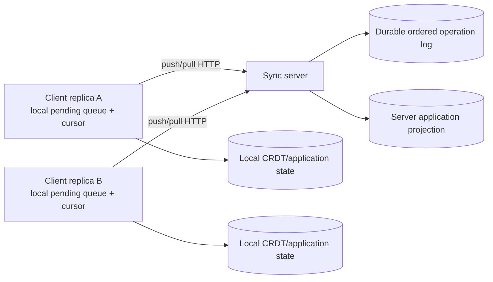

# Server-Mediated Synchronization Protocol

## Status

This document defines the Milestone 4 protocol. The server is a durable
operation-log authority; replicas still apply operations with deterministic
CRDT merge rules. Delivery is at-least-once and application is idempotent.
This protocol does not provide direct peer-to-peer or LAN synchronization.

## Topology

The server log position is an acceptance-order position. It is not a causal
timestamp and must not replace operation version metadata.

## Operation format

Versioned retail operations retain their existing schema:

- `schemaVersion: 2`
- globally unique `operationId`
- originating `replicaId`
- entity/object identifier
- CRDT operation kind
- operation-specific payload
- `version: { logicalTime, replicaId, operationId }`

`logicalTime` is a client logical clock value used only by the deterministic
retail version comparator. It is not wall-clock time and is not a causal proof.
The server assigns a separate monotonically increasing `logPosition` after
durable append.

## Push and pull

`POST /v1/sync/operations` accepts a bounded batch of versioned operations.
The server validates each operation, appends new operation IDs durably, and
returns one result per input:

- `accepted`: operation durably appended and applied to the server projection
  for the current process; the projection is reconstructed from the log after a
  restart.
- `duplicate`: operation ID already exists and is not appended again.
- `rejected`: validation or application failure; the client must not retry
  unchanged data.

`GET /v1/sync/operations?after=<cursor>&limit=<n>` returns operations with
positions strictly greater than `after`, in ascending log order. The response
includes `nextCursor` and `hasMore`.

Clients apply a returned batch idempotently, persist the resulting local state,
then advance their local cursor to `nextCursor`. A cursor is never advanced
before the batch is durably applied locally. Repeating a pull after a crash is
safe because operation application is idempotent.

## Cursor semantics

Cursors are per-client delivery cursors over one global server log. The server
does not advance a client cursor; clients acknowledge progress by requesting
the next range. The server log position is an acceptance-order index, while
CRDT versions determine conflict resolution. A lost acknowledgement or
interrupted batch causes replay, not data loss.

## Failure semantics

- Duplicate submission: returns `duplicate`; no second effect.
- Duplicate delivery: local operation ID set prevents a second effect.
- Out-of-order delivery: versioned CRDT merge is deterministic; cursor order is
  only transport order.
- Client crash: pending operations and cursor are restored; push/pull repeats.
- Server crash: the durable log and projection reload from the store.
- Lost acknowledgement: client resubmits; server returns `duplicate`.
- Interrupted pull: cursor remains at the previous durable position.
- Long offline period: client pulls bounded pages until `hasMore` is false.
- Concurrent writes: deterministic field/version merge is used by the retail
  projection and client application.
- Partial synchronization: each page is independently retryable.

Exactly-once network delivery is not claimed. The protocol is at-least-once
with idempotent operation application.

## Persistence and observability

The log is durably persisted through the existing atomic file store, and the
projection is rebuilt from the log on server startup. Metrics distinguish
generated, submitted, accepted, duplicate, retrieved, and applied operations.
Transport framing and packet-level bandwidth remain unavailable at this HTTP
boundary and are reported as `null`.

## Current implementation boundary

The versioned push/pull endpoints and durable log are implemented for callers
that already produce `VersionedRetailOperation` values. `BackendApiClient`
exposes `pushVersionedOperations` and `pullVersionedOperations`. The existing
browser `SyncEngine` still produces legacy `RetailOperation` values and its
localStorage cursor is not yet wired to these endpoints. Converting legacy
whole-object drafts into causal versioned operations would be an unsafe
semantic shortcut, so full browser-path integration is intentionally a
follow-up milestone rather than a falsely claimed completion here.
