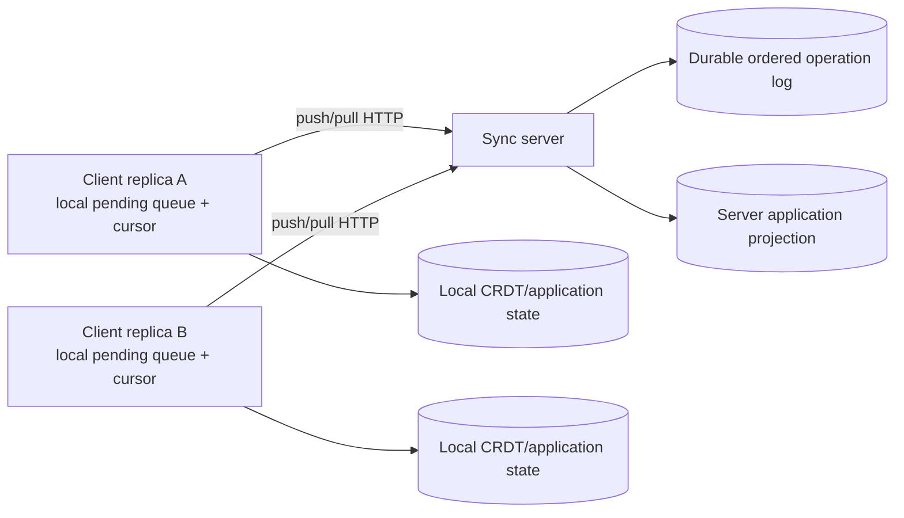

# Server-Mediated Synchronization Protocol

## Status

This document defines the Milestone 4 protocol. The server is a durable
operation-log authority; replicas still apply operations with deterministic
CRDT merge rules. Delivery is at-least-once and application is idempotent.
This protocol does not provide direct peer-to-peer or LAN synchronization.

## Topology

The server log position is an acceptance-order position. It is not a causal
timestamp and must not replace operation version metadata.

## Operation format

Versioned retail operations retain their existing schema:

- `schemaVersion: 2`
- globally unique `operationId`
- originating `replicaId`
- entity/object identifier
- CRDT operation kind
- operation-specific payload
- `version: { logicalTime, replicaId, operationId }`

`logicalTime` is a client logical clock value used only by the deterministic
retail version comparator. It is not wall-clock time and is not a causal proof.
The server assigns a separate monotonically increasing `logPosition` after
durable append.

## Push and pull

`POST /v1/sync/operations` accepts a bounded batch of versioned operations.
The server validates each operation, appends new operation IDs durably, and
returns one result per input:

- `accepted`: operation durably appended and applied to the server projection
  for the current process; the projection is reconstructed from the log after a
  restart.
- `duplicate`: operation ID already exists and is not appended again.
- `rejected`: validation or application failure; the client must not retry
  unchanged data.

`GET /v1/sync/operations?after=<cursor>&limit=<n>` returns operations with
positions strictly greater than `after`, in ascending log order. The response
includes `nextCursor` and `hasMore`.

Clients apply a returned batch idempotently, persist the resulting local state,
then advance their local cursor to `nextCursor`. A cursor is never advanced
before the batch is durably applied locally. Repeating a pull after a crash is
safe because operation application is idempotent.

## Cursor semantics

Cursors are per-client delivery cursors over one global server log. The server
does not advance a client cursor; clients acknowledge progress by requesting
the next range. The server log position is an acceptance-order index, while
CRDT versions determine conflict resolution. A lost acknowledgement or
interrupted batch causes replay, not data loss.

## Failure semantics

- Duplicate submission: returns `duplicate`; no second effect.
- Duplicate delivery: local operation ID set prevents a second effect.
- Out-of-order delivery: versioned CRDT merge is deterministic; cursor order is
  only transport order.
- Client crash: pending operations and cursor are restored; push/pull repeats.
- Server crash: the durable log and projection reload from the store.
- Lost acknowledgement: client resubmits; server returns `duplicate`.
- Interrupted pull: cursor remains at the previous durable position.
- Long offline period: client pulls bounded pages until `hasMore` is false.
- Concurrent writes: deterministic field/version merge is used by the retail
  projection and client application.
- Partial synchronization: each page is independently retryable.

Exactly-once network delivery is not claimed. The protocol is at-least-once
with idempotent operation application.

## Reliability and recovery

The browser persists pending operations, their stable operation IDs and
versions, the applied-operation ID set, the logical clock, and the pull cursor
in the local synchronization record. A pending operation is removed only
after the push response is received; if the server accepted the operation but
the response is lost, retrying the same operation returns `duplicate` and is
safe.

Push batches are not transactional. The server appends and persists entries
sequentially, so a validation or transport failure can leave a prefix
accepted. Retrying the complete batch is safe: accepted entries return
`duplicate`, and only missing entries are appended. Callers must inspect
individual results when a response is available.

Pulls are paginated. Each page is applied through the idempotent repository
handler and then the cursor is persisted. An interruption after page
application but before cursor persistence can replay that page; the applied
operation IDs and field-version metadata make the replay a no-op. An
interruption during a later page leaves the previous cursor intact, so the
next synchronization resumes without a gap.

The backend uses **log-authoritative recovery** rather than a cross-record
transaction. The versioned operation log is the source of truth. The
materialized versioned projection is rebuildable and is never trusted as the
only copy of an operation. On startup, the server writes a recovery checkpoint
with `status: "recovering"`, replays the complete durable log in acceptance
order, then writes `status: "complete"` with the last replayed log position.
An incomplete or malformed checkpoint causes startup recovery to replay or fail
explicitly; requests cannot be served until construction and replay complete.
Checkpoint advancement occurs only after the corresponding operation has been
applied, so it cannot skip a durable log entry.

For a versioned operation, the sequence is:

1. Validate the operation and check its stable identity.
2. Durably append a new operation to the ordered log.
3. Mark the recovery checkpoint as `recovering`.
4. Apply the operation to the in-memory CRDT projection.
5. Mark the checkpoint `complete`.
6. Return the acknowledgement.

The append is failure-atomic in memory: an operation is added to the
in-memory index only after the durable store accepts the new log state. If a
process fails after append, during runtime application, during checkpoint
persistence, or after checkpoint persistence but before the response, restart
replays the log and reconstructs the same state. A failure before append leaves
no operation to recover. This establishes recoverable at-least-once
synchronization and replay safety, not exactly-once transport or a single
atomic transaction spanning browser storage and HTTP.

Automatic retry is bounded by the application's retry scheduling; transient
failures leave operations in the pending queue and surface an error. The
protocol itself does not retry indefinitely, and packet-level network
delivery, process-kill timing, and browser storage failure are not fully
measured by the test suite.

## Product conflict semantics

Product updates use `product.patch`; the `changes` object contains only the
fields changed by that user action. The server and browser repository maintain
the latest `RetailVersion` independently for each product field, so concurrent
updates to different fields are both retained.

For one field, the greater version wins using this exact total order:

1. greater `logicalTime`;
2. UTF-8 bytewise comparison of `replicaId`;
3. UTF-8 bytewise comparison of `operationId`.

The logical clock is advanced before local operation creation and is raised to
at least every received logical time before later local creation. This gives
causally later local edits a greater logical time; the replica and operation
identifiers provide deterministic tie-breaking for concurrent equal times.
Delivery order and duplicate delivery do not affect the result.

`product.delete` creates a tombstone that blocks patches until a newer
`product.restore` arrives. A restore replaces the visible product and
establishes its version as the baseline for subsequent field patches. Older
deletes, restores, and patches cannot overwrite that state. This policy is
implemented in both the server projection and browser repository metadata.

## Persistence and observability

The log is durably persisted through the existing atomic file store, and the
projection is rebuilt from the log on server startup. Product tombstones,
per-field version registers, inventory effects, and applied operation
identities are reconstructed by replay rather than treated as independent
durable authorities. Metrics distinguish
generated, submitted, accepted, duplicate, retrieved, and applied operations.
Transport framing and packet-level bandwidth remain unavailable at this HTTP
boundary and are reported as `null`.

## Current implementation boundary

The versioned push/pull endpoints and durable log are implemented for browser
callers. `BackendApiClient` exposes `pushVersionedOperations` and
`pullVersionedOperations`, and `SyncEngine` derives a stable versioned
operation at the repository enqueue boundary. Its logical clock, pending
operations, applied-operation IDs, and global-log cursor are persisted in the
existing `syncdesk.sync.v1` record. Push acknowledgement removes a pending
operation only after acceptance or duplicate identity is returned; pull
application occurs before cursor advancement.

The legacy `RetailOperation` remains in pending records for UI and migration
compatibility, but it is no longer the browser transport format. Pulled
operations use the repository's version-aware handler and are never
re-enqueued. Legacy backend methods remain available for callers outside the
browser `SyncEngine`.
