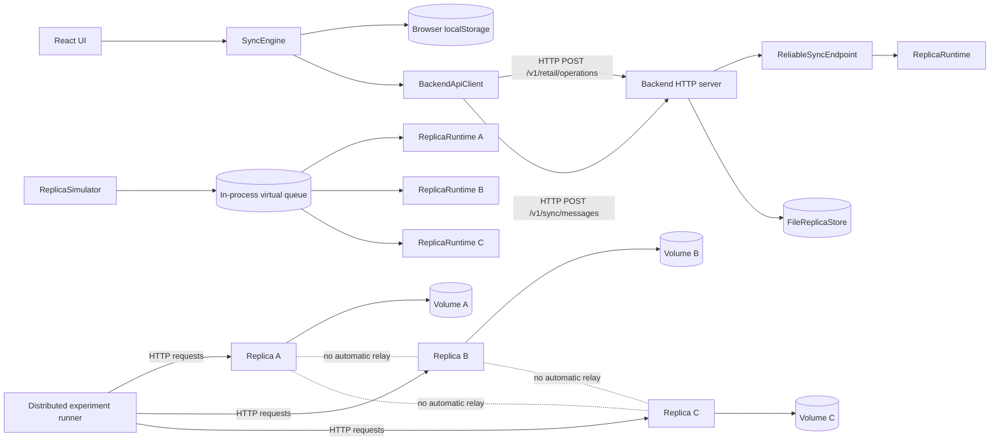
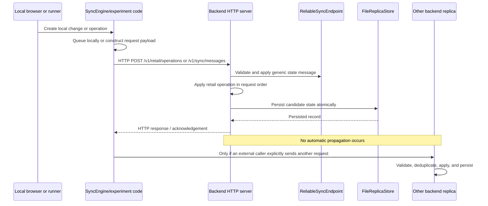

# Synchronization Architecture Audit

**Audit baseline:** `fff9c015742bbeeff5ede2501e78498f7b27e02a`  
**Reported baseline:** `fff9c01`  
**Audit date:** 2026-11-04  
**Scope:** architecture and protocol inspection; no CRDT, persistence, or
frontend behavior changes.

## A. Executive finding

The implemented system is **server-mediated HTTP synchronization plus an
in-process CRDT simulator**. It is not direct peer-to-peer synchronization and
it is not a hybrid LAN synchronizer.

The backend exposes HTTP endpoints that accept a full-state generic sync
message and request-ordered retail operations. A caller must choose the target
HTTP server. The backend does not discover replicas, maintain a subscription
set, relay received operations, send outbound messages, or expose a missed-
operation cursor. The three-process experiment is genuine socket communication
between the experiment runner and three backend processes, but the backend
processes do not communicate with one another automatically.

The browser path is a separate local/offline simulation. `SyncEngine` maintains
localStorage state, a pending queue, simulated remote changes, and a
price-only last-writer-wins merge. It optionally sends pending operations to one
configured `BackendApiClient`; it does not instantiate the generic backend
replica protocol as a browser replica.

## B. Actual architecture

The dashed edges are intentionally non-communication edges: no corresponding
outbound peer transport exists in the backend server.

## C. Update sequence

For generic messages, `ReliableSyncEndpoint.receive` merges a full snapshot and
returns an acknowledgement. For retail operations, `RetailDomainRuntime.apply`
mutates a catalog and records an operation ID; this is not field-level CRDT
merge behavior.

## D. Component and source-code map

| Component | Responsibility | Source evidence | Verified behavior | Limitation |
|---|---|---|---|---|
| Browser sync engine | Local queue, connectivity state, simulated remote merge | [`SyncEngine.ts`](../src/services/sync/SyncEngine.ts), `enqueue`, `goOffline`, `finishSync` | Persists pending state and optionally calls one backend client | Documentation explicitly says it has no real CRDT; remote queue is local simulation |
| Browser backend client | HTTP request construction | [`backendApi.ts`](../src/services/backendApi.ts), `syncChanges`, `syncRetailOperations` | Sends requests to one configured base URL | No peer discovery, fanout, inbound listener, or operation cursor |
| HTTP backend | Health, state inspection, retail and generic sync endpoints | [`server.ts`](../src/backend/api/server.ts), `createBackendServer` | Accepts TCP HTTP requests, serializes writes with `requestChain`, persists before publishing state | No outbound transport, relay, subscription, or server-side missed-operation exchange |
| Generic protocol | Full-state message and acknowledgement schemas | [`protocol.ts`](../src/backend/sync/protocol.ts) | Validates protocol/version/identity and 1 MiB encoded limit | No delta, causal frontier, or operation log |
| Generic endpoint | Merge snapshots and suppress duplicate message IDs | [`reliability.ts`](../src/backend/sync/reliability.ts), `receive` | Duplicate IDs return `duplicate`; valid snapshots merge | Deduplication is endpoint-local and does not create recovery discovery |
| CRDT runtime | LWW register, OR-Set, PN-counter, HLC state | [`replica.ts`](../src/backend/crdt/replica.ts), `merge` | Snapshot joins are deterministic for the generic CRDT types | Generic runtime is not wired into retail catalog conflict resolution |
| Retail runtime | Request-order catalog mutation and operation ID set | [`retail.ts`](../src/backend/api/retail.ts), `RetailDomainRuntime.apply` | Duplicate operation IDs are ignored; accepted operations persist | Concurrent same-entity operations are not merged by retail versions/tombstones |
| Persistence | Durable JSON records, atomic replacement and lock | [`ReplicaStore.ts`](../src/backend/persistence/ReplicaStore.ts), `FileReplicaStore.save` | Generic and retail records survive process restart | No operation-log replay or cross-replica reconciliation |
| Process experiment | Coordinates three HTTP servers | [`run-distributed-experiment.mjs`](../scripts/run-distributed-experiment.mjs) | Uses real HTTP sockets and explicit replay to each URL | Runner, not replicas, performs fanout and reconnect replay |
| In-memory simulator | Virtual delay, loss, duplication, partitions, restart | [`simulator.ts`](../src/backend/sync/simulator.ts) | Exercises modeled CRDT delivery paths | No sockets, TCP, HTTP, packet loss, or process boundaries |

## E. Protocol semantics

### Generic synchronization protocol

`StateSyncMessage` contains `type: "state"`, protocol name, version `1`,
`messageId`, `fromReplicaId`, and a complete `ReplicaSnapshot`. The receiver
validates that the snapshot identity matches the sender and rejects malformed or
oversized messages. It merges the snapshot into its local CRDT runtime and
returns an acknowledgement with status `applied` or `duplicate`.

The server persists the candidate endpoint state and applied message IDs before
publishing the successful HTTP response. The server request chain serializes
concurrent writes within one process.

### Retail protocol

`POST /v1/retail/operations` receives a non-empty array. Each operation is
validated and applied in request order. The runtime keeps an applied operation
ID set and returns duplicate status for repeated IDs. The catalog and operation
ID set are persisted together in the retail record.

The retail endpoint does not use `validateVersionedRetailOperation` or the
research field-level merge model. It has no tombstone for a deleted catalog
object and no causal cursor for operations missed while offline.

### Delivery, retry, and acknowledgement

- HTTP transmission: verified by [`backendApi.test.ts`](../src/services/backendApi.test.ts), including a real local HTTP server.
- Generic acknowledgement: created by `ReliableSyncEndpoint`, returned by the HTTP handler.
- Client retry object: `ReliableSyncSender` can retry a message ID up to a configured limit, but `BackendApiClient` does not use it.
- Browser retry: `SyncService` schedules a five-second retry after a frontend error when auto-retry is enabled.
- Server-side retry: not implemented.
- Acknowledgement-loss recovery: not implemented as an automatic HTTP client workflow.
- Persistent outbound queue: browser pending changes are persisted in localStorage; backend received operation IDs/state are persisted. There is no backend outbound queue.

## F. End-to-end lifecycle evidence

| Stage | Actual implementation | Evidence classification |
|---|---|---|
| Local operation creation | `MockRepository` creates `ChangeDraft`; `SyncEngine.enqueue` assigns local ID and queues it | Automated frontend tests and code inspection |
| CRDT mutation | Generic `ReplicaRuntime` mutates CRDT primitives; browser retail path does not use it | Unit tests plus code inspection |
| Serialization | `createStateMessage` and `encodeSyncMessage`; retail operations are JSON request bodies | Unit tests and code inspection |
| Local persistence | Browser localStorage; backend `FileReplicaStore` | Persistence tests and code inspection |
| Outbound message creation | `BackendApiClient.syncChanges` creates a full generic snapshot and sends retail operations separately | Backend API tests and code inspection |
| Transport selection | `fetch` to one configured HTTP base URL | Real local HTTP test and code inspection |
| Network transmission | Node HTTP server test uses loopback TCP; three-process runner uses HTTP URLs | Local process run; Docker not executed |
| Reception | `server.ts` request handler parses body and invokes runtime | Backend API tests |
| Validation/deduplication | Protocol validation and message/operation ID sets | Reliability/server tests |
| CRDT merge/application | Generic endpoint merges snapshots; retail applies request-order mutations | Reliability tests; retail tests |
| Acknowledgement | Generic endpoint returns acknowledgement in HTTP response | Reliability/server tests |
| Received-state persistence | Candidate is persisted before endpoint/catalog replacement | Server persistence failure tests |
| Propagation to other replicas | No backend propagation code; runner explicitly posts to each URL | Code inspection and runner source |
| Reconnection recovery | Browser retries pending local changes; runner explicitly resubmits workload | Local process runner; no automatic missed-operation recovery |

## G. Protocol and failure-semantics audit

| Behavior | Evidence type | Finding |
|---|---|---|
| Duplicate generic message | In-memory and HTTP automated tests | Verified: same message ID is acknowledged as duplicate |
| Duplicate retail operation | HTTP/runtime tests and local runner | Verified: operation ID prevents repeated catalog effect |
| Out-of-order generic state delivery | CRDT simulator tests | Verified in modeled full-state merge; not a real network test |
| Out-of-order retail operations | Local runner replay | The tested workload converges because operations target distinct objects plus a final delete; general conflict semantics remain request-order |
| Message loss | Simulator tests | Verified only in virtual queue; no transport retransmission evidence |
| Temporary disconnection | Browser simulation and simulator | Local state can remain pending; no backend subscription/reconnect protocol |
| Long offline period | Simulator tests | Modeled convergence if states are later exchanged; no server operation-log recovery |
| Process restart | Persistence/API tests and local process smoke run | Verified for stored state and identity using the same file store |
| Server restart | Same backend persistence mechanism | Verified by tests; no multi-process Docker execution |
| Concurrent updates | Generic CRDT unit/simulator tests | Verified for generic primitives; retail endpoint is not a CRDT conflict resolver |
| Acknowledgement loss | Code inspection | No automatic client recovery path proven |
| Partial synchronization | Full snapshot endpoint | No delta/cursor protocol; caller must send a snapshot or operations |
| Idempotency | Endpoint and retail operation ID sets | Verified within persisted endpoint/runtime state |
| Persistent operation queue | Browser pending queue only | Backend outbound queue not implemented |
| Conflict resolution | Generic LWW/OR-Set/PN-counter; browser price LWW | Retail production endpoint uses request order, not the research versioned model |

## H. Real network topology answers

1. **Can replica A send directly to replica B?** No built-in mechanism. A caller can
   manually POST to B while claiming A as `fromReplicaId`, but replica A has no
   peer address configuration or outbound fanout code.
2. **Can A synchronize with B while the central server is unavailable?** There is
   no central relay protocol to bypass; if B is an independently running HTTP
   server, an external caller could address it, but A itself cannot do so.
3. **Does the server relay or persist operations for disconnected replicas?** It
   persists accepted state and IDs for itself. It does not relay or maintain a
   per-recipient operation log.
4. **How does a reconnecting replica discover missed operations?** It does not.
   The runner or caller must explicitly resubmit operations/full state.
5. **Is there an operation log, version cursor, vector clock, or equivalent?**
   Generic CRDT metadata includes HLC and OR-Set knowledge vectors, but there is
   no delivery cursor or operation log for endpoint recovery.
6. **What happens during extended server unavailability?** Browser changes remain
   in the local pending queue and can retry; backend-side missed update recovery
   is not implemented.
7. **Are replicas independently LAN-addressable?** Backend processes can bind to
   configured host/port, but no replica registry or peer configuration exists.
8. **Is peer discovery implemented?** No.
9. **Does every synchronization exchange require a central server?** The browser
   path requires its configured backend. Generic endpoints can receive direct HTTP
   requests, but there is no replica-initiated exchange.
10. **Do three local processes communicate over sockets?** In the local process
   experiment, the runner communicates with each backend over loopback HTTP
   sockets. The backend processes do not communicate directly.

## I. Implementation versus research assumptions

| Intended/design concept | Implemented reality | Defensible interpretation |
|---|---|---|
| Central-server reference architecture | One HTTP backend can receive and persist requests | Partially implemented; no server fanout or missed-operation log |
| Direct LAN fallback | No peer transport, discovery, or peer addresses | Not implemented |
| Offline-first operation | Browser local queue/localStorage and simulated connectivity | Supported for local queueing, not full distributed replication |
| Persistent local state | Browser localStorage and backend atomic JSON files | Supported within tested failure model |
| Recovery after intermittent connectivity | Browser retry and explicit experiment replay | Partially supported; automatic distributed recovery is absent |
| Multi-replica convergence | Generic simulator and explicit runner replay | Supported only when a caller exchanges state/operations; not automatic |
| Retail CRDT conflict model | Research simulator has versioned candidate logic | Not the production retail HTTP runtime |

## J. Evidence matrix

| Capability | Evidence type | Location | Result | Confidence / limitation |
|---|---|---|---|---|
| Real HTTP request reaches backend | Automated loopback integration test | `src/services/backendApi.test.ts` | Pass | High for one local process |
| Three process identities | Local process runner output | `run-distributed-experiment.mjs` | Pass locally | No Docker evidence |
| Automatic peer fanout | Source inspection | `server.ts`, `backendApi.ts` | Absent | High confidence |
| Generic CRDT merge | Unit/simulator tests | `src/backend/crdt`, `src/backend/sync` | Pass | In-memory/full-state model |
| Retail operation preservation | Local process runner | Runner output | Pass for tested workload | Request-order semantics |
| Missed-operation discovery | Source inspection | No cursor/log endpoint | Absent | High confidence |
| Duplicate generic delivery | Automated tests | `reliability.test.ts`, `server.test.ts` | Pass | Endpoint-local IDs persisted |
| Restart persistence | Automated tests/local process run | `ReplicaStore.test.ts`, `backendApi.test.ts` | Pass | Docker restart untested |
| Network delay/loss | In-memory simulator | `simulator.ts` tests | Pass as model | Not packet-level evidence |
| LAN synchronization | No source/test evidence | No peer transport | Not supported | High confidence |

## K. Architecture limitations

1. There is no automatic replica-to-replica transport, peer discovery, or
   subscription/fanout mechanism.
2. There is no durable operation log or per-replica delivery cursor, so a
   reconnecting node cannot ask the server for exactly what it missed.
3. The generic endpoint accepts full snapshots, not deltas or operation batches.
4. `ReliableSyncSender` is a reusable retry helper but is not wired into the
   browser HTTP client.
5. The production retail endpoint applies request-order whole-object mutations;
   the research versioned retail merge model is not used there.
6. The process runner coordinates all three replicas externally and therefore
   does not demonstrate autonomous synchronization.
7. Real network fault, Docker, packet loss, latency, and bandwidth behavior are
   unresolved because Docker is unavailable in this environment.

## L. Docker validation readiness

| Experiment | Required topology | Fault | Observable pass condition | Cannot prove |
|---|---|---|---|---|
| Normal HTTP exchange | Runner plus three backend containers | None | Health checks and explicit operation replay produce equal semantic catalogs | Autonomous peer fanout |
| Server disconnection | Runner plus target backend | Disconnect target container | Requests fail, then succeed after reconnect; resubmitted workload converges | Automatic missed-operation discovery |
| Replica restart | One backend volume per container | Restart one container | Same replica ID, persisted catalog/IDs, subsequent explicit replay succeeds | Crash consistency under kill/torn write |
| Intermittent endpoint | Three containers | Repeated disconnect/connect | Explicit replay remains idempotent and final state is correct | Transport-level retry behavior |
| Delay/loss | In-process simulator or future proxy | Virtual delay/drop | Simulator reports modeled convergence | TCP packet behavior |
| Duplicate/reorder | Runner operation schedule | Repeated reverse-order requests | No duplicate effects and expected final catalog | General retail conflict convergence |
| Long offline | One isolated backend plus external replay | Extended disconnect | Explicit replay restores expected semantic state | Server-side operation history |

Docker must be available before any of these can be called Docker results.

## M. Research-claim assessment

| Claim | Assessment |
|---|---|
| “The generic CRDT merge primitives are deterministic under tested in-memory delivery schedules.” | Supported by implementation and tests |
| “The browser provides offline local queueing.” | Supported by implementation and tests |
| “Three local backend processes can be addressed over HTTP by an external runner.” | Supported by the local process run |
| “Replicas automatically synchronize peer-to-peer over a LAN.” | Not supported |
| “The server automatically recovers every missed operation after reconnect.” | Not supported |
| “The retail HTTP endpoint provides CRDT conflict resolution.” | Not supported; it applies request-order operations |
| “The system converges after explicit state/operation exchange for the tested workload.” | Partially supported; local process evidence exists, but scope is workload-specific |
| “The system tolerates real packet loss, delay, or bandwidth constraints.” | Not yet evaluated |
| “Docker Compose provides validated distributed runtime behavior.” | Not supported until Docker executes successfully |

## N. Recommended next milestone

The smallest defensible next step is **server-mediated synchronization with a
durable operation log and per-replica delivery cursor**. It preserves the
current central topology, makes missed-update recovery explicit, and can be
tested without inventing peer discovery or LAN routing.

Trade-offs:

1. **Server-mediated only:** smallest change, but offline replicas require
   server availability and a durable server-side history.
2. **Server-mediated plus durable operation log:** recommended; supports
   reconnect recovery and measurable delivery progress, at the cost of log
   retention/compaction design.
3. **Hybrid LAN relay:** lower central dependency but requires peer discovery,
   authorization, routing, duplicate handling, and a clear authority model.
4. **Direct peer-to-peer:** largest architectural change; requires discovery,
   membership, security, anti-entropy, and offline peer recovery.

No option above is implemented by this audit.
